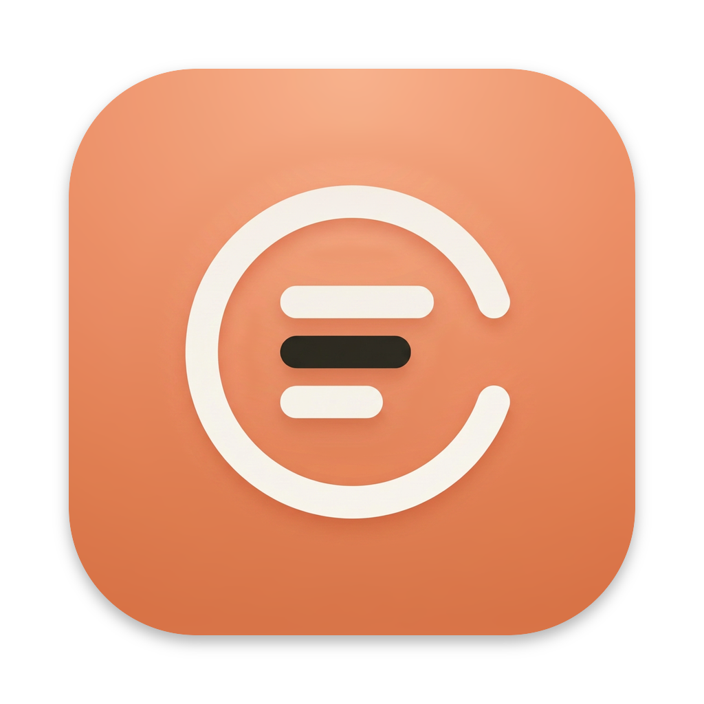
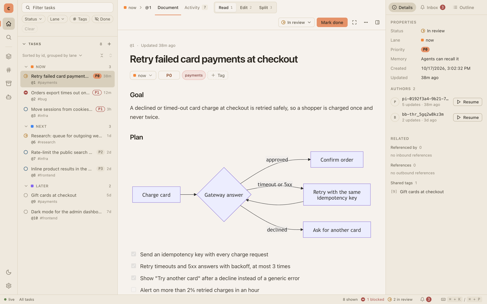
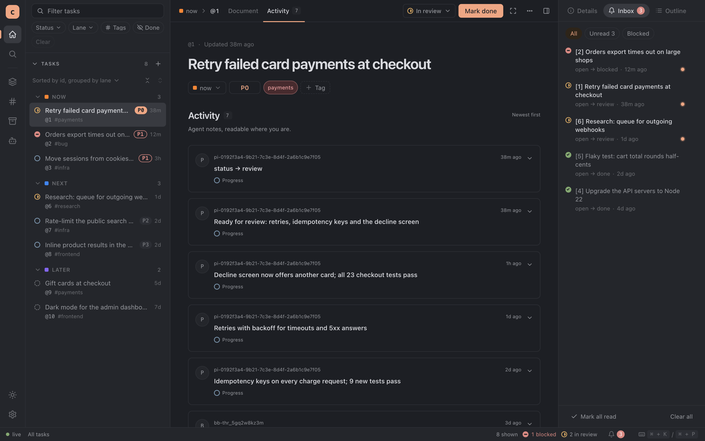
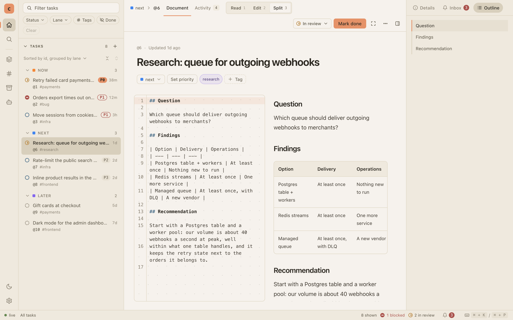

<p align="center">
  
</p>

<h1 align="center">cortex</h1>

<p align="center">A local task tracker for one engineer supervising several AI coding agents at once.</p>

Your agents post progress, status changes and plans to cortex from the command line. You watch it all live in the
desktop app, and cortex interrupts you only when an agent is blocked. Tasks double as memory, so the next agent
session picks up where the last one stopped.



- **One binary.** The CLI and a small background daemon; plain `cortex` opens the desktop app.
- **Local and private.** One SQLite file under `~/.config/cortex`, a private Unix socket, no network listener, no
  accounts.
- **Live.** A change from any agent shows up in every app window at once.
- **Made for agents.** Stable `--json` output, updates credited to each agent session, and skills, a pi extension and a
  bb plugin that teach agents the conventions.

## Install

You need Node.js and pnpm; Bun comes in as a dev dependency.

```bash
pnpm install --frozen-lockfile
pnpm run desktop:dist  # package the desktop app (skip it for the CLI alone)
pnpm run deploy        # install cortex into ~/bin (keep it on your PATH) and the desktop app
cortex init            # create your database
cortex agents install  # teach your agents: skills, plus pi and bb support if you use them
```

Then run `cortex` to open the app. It is signed ad hoc, so a copy downloaded from elsewhere needs a right-click and
Open the first time.

## Quick start

```bash
cortex add "ship the login page" -p 0                             # a task; priority 0 is the highest
cortex update 1 -m "tests pass" -s review --as my-agent-1a2b3c4d  # what an agent posts
cortex                                                            # watch it in the desktop app
```

A task moves through draft, open, review, blocked and done. Only a move into blocked raises a notification.

<p align="center">
  
  
</p>
<p align="center"><sub>Left: everything the agents posted on a task, and the Inbox of status changes. Right: a task's
Markdown beside its preview.</sub></p>

## Learn more

- [The desktop app](docs/desktop.md): reading, editing and triaging tasks, and how the app is built.
- [Agent memory](docs/memory.md): how agents keep and find their working state, with or without pi.
- [Cortex in bb](docs/bb.md): each thread's task beside the conversation, and memory tools for every provider.
- [How cortex works](docs/architecture.md): the daemon, where your data lives, and what happens when agents collide.
- `cortex --help`, `cortex schema` and `cortex doctor`: every command, the data model for agents, and a health check.

## Development

`pnpm run desktop:dev` and `pnpm run dev -- <command>` run cortex from source on a sandbox in `tmp/dev/`, so
unreleased code never touches your real data. [AGENTS.md](AGENTS.md) has the commands, tests, conventions and the
checks to run before a PR.
